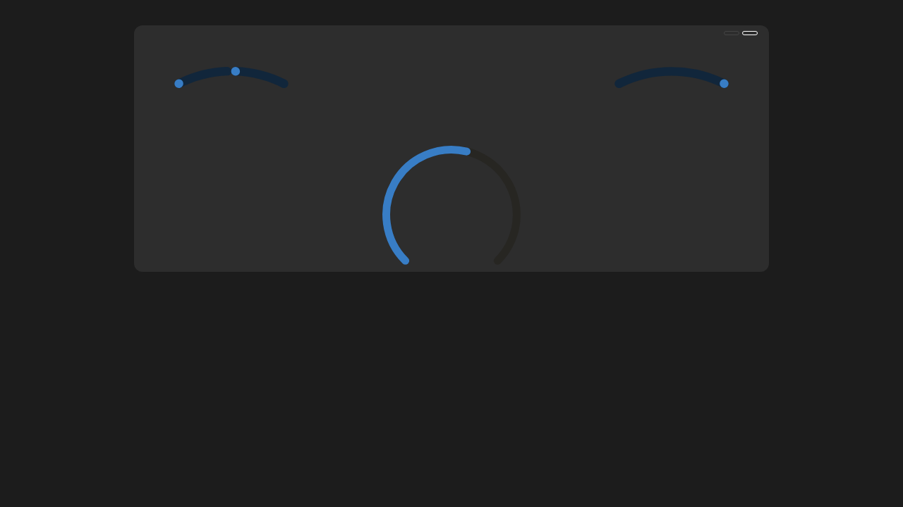
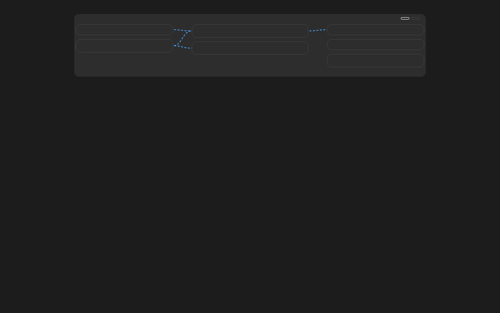

# Victron Remote Console (HACS)

A Home Assistant Lovelace card that recreates the **Victron Remote Console v2** *Overview* and *Brief* views, so you can see your system's energy state at a glance — powered entirely by entities you already have in Home Assistant (e.g. from the Victron Venus OS integration).

| Brief | Overview |
| --- | --- |
|  |  |

## Features

- **Brief view**: large central battery gauge with state of charge, charge/discharge direction and time-to-go, flanked by arc gauges for AC input, solar, AC loads and DC loads.
- **Overview view**: three-column energy flow diagram — inputs (grid/genset/shore, solar, DC sources) on the left, inverter/charger and battery in the center, loads and EV charger on the right — with animated connector flows.
- **Visual editor**: configure every element with Home Assistant's entity picker; no YAML needed. Per-element *invert* toggles for sign conventions.
- **No new integrations**: the card reads `hass.states` only. No MQTT, no extra credentials.
- Missing elements are shown greyed-out (Overview) or omitted (Brief), like the real console does for absent devices.

## Installation

### HACS (recommended)

1. In HACS, go to **⋯ → Custom repositories**.
2. Add `https://github.com/blaet/hacs-victron-remote-console` with category **Lovelace**.
3. Find **Victron Remote Console** and download it.
4. Add the card from **Edit dashboard → Add card → Victron Remote Console** (or see YAML below).

### Manual

Copy `dist/victron-remote-console.js` into `<config>/www/` and add a resource:

```yaml
resources:
  - type: module
    url: /local/victron-remote-console.js
```

## Configuration

All elements are optional. Pick entities in the card's visual editor, or configure in YAML:

```yaml
type: custom:victron-remote-console-card
view: overview        # overview | brief
title: Home
elements:
  battery_soc: sensor.victron_battery_soc
  battery_power: sensor.victron_battery_power
  battery_voltage: sensor.victron_battery_voltage
  battery_current: sensor.victron_battery_current
  battery_time_to_go: sensor.victron_battery_time_to_go
  ac_input_power: sensor.victron_grid_power
  solar_power: sensor.victron_pv_power
  solar_yield_today: sensor.victron_pv_yield_today
  inverter_power: sensor.victron_inverter_power
  inverter_state: sensor.victron_inverter_state
  ac_loads_power: sensor.victron_ac_loads
  dc_loads_power: sensor.victron_dc_loads
  ev_power: sensor.victron_evcharger_power
  ev_state: sensor.victron_evcharger_state
invert: []            # element keys whose sign convention should be flipped
show_connectors: true # animated flow lines in Overview
```

### Sign conventions

The card assumes:

- **battery power / inverter power**: positive = charging
- **AC input power**: positive = importing from grid/genset/shore
- **loads / solar / DC sources**: positive = producing or consuming

If an entity uses the opposite convention (e.g. feed-in shown as negative), add its key to `invert` (or toggle it in the visual editor).

## Element reference

| Section | Keys |
| --- | --- |
| Battery | `battery_soc`, `battery_power`, `battery_voltage`, `battery_current`, `battery_time_to_go`, `battery_capacity`, `battery_name` |
| AC input | `ac_input_power`, `ac_input_current`, `ac_input_voltage`, `ac_input_source` |
| Solar | `solar_power`, `solar_yield_today`, `solar_yield_total` |
| Inverter | `inverter_power`, `inverter_state` |
| Loads | `ac_loads_power`, `ac_loads_critical_power`, `dc_loads_power` |
| EV charger | `ev_power`, `ev_state` |
| DC sources | `alternator_power`, `wind_power`, `dc_generator_power` |
| Environment | `temperature` |

## Development

```
src/         modular sources (ES modules)
tools/       bundle + visual verification harness
dist/        bundled single file loaded by HA (do not edit)
```

- `npm run build` — bundle `dist/` from `src/`
- `npm run verify` — render both views with mocked states and screenshot them (first run auto-installs dependencies)
- `npm run check` — build + verify
- `npm run clean` — remove all repo-local dev state

### Local-run isolation

Nothing is installed outside the repository: `.npmrc` keeps the npm cache in `./.npm-cache`, dependencies install to `./node_modules`, and Playwright's browser downloads go to `./.cache`. All of these are gitignored, and `npm run clean` removes them completely. No global installs, no writes to your home directory. (Chromium may need system libraries on first use — if so the verify script prints the one-liner `sudo npx playwright install-deps chromium`, which is the only step that touches your OS.)
## Acknowledgements

The Overview and Brief views are modeled on Victron Energy's [GUI v2](https://github.com/victronenergy/gui-v2) (the Venus OS / VRM remote console). This project contains no Victron source code; it is an independent implementation that follows the design and behavior of the original console, and is intended for use with Victron Energy systems.

## License

MIT — see [LICENSE](LICENSE).
